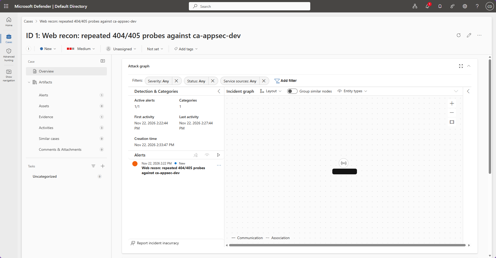

Most companies have a CI/CD pipeline and a SIEM, and the two rarely talk to each other. The pipeline knows what got deployed and whether it passed a scan. The SIEM knows something strange happened at runtime. Neither one has the other's context, so when an incident lands, the first hour goes to working out what was running and where it came from.

I built `azure-appsec-pipeline` to close that gap. Here is what it does, what broke along the way, and what I'd change.

Repo: [github.com/ArtistYay/azure-appsec-pipeline](https://github.com/ArtistYay/azure-appsec-pipeline)

## What I built

A small Flask app runs on Azure Container Apps. Two GitHub Actions workflows put it there.

The app workflow runs unit tests, Bandit for Python code, and Gitleaks across the full git history. Then it builds the Docker image and scans it with Grype before it can reach the registry. If the scan passes, the image is pushed to Azure Container Registry tagged with the exact commit SHA, and deployed after I approve it. A smoke test hits `/health` to confirm the new version is alive.

The infrastructure workflow checks the Terraform with `fmt`, `validate`, tflint and Checkov, runs a plan on every pull request, and only applies on `main` after I approve it.

At runtime, the app writes structured JSON logs. Container Apps sends them to Log Analytics, and Microsoft Sentinel runs a detection rule over them. When one IP hits 10 or more missing pages or wrong HTTP methods in five minutes, which is what directory brute forcing and vulnerability scanners look like, Sentinel opens an incident.



I tested it by acting like a scanner. Ten requests to paths like `/.env`, `/wp-login.php` and `/.git/config`, plus one POST to a GET-only endpoint. A few minutes later the incident was there, and the running image traced straight back to one commit.

## Why every image carries a commit SHA

Tagging with `latest` means you can't say what's running. A SHA tag means every container maps to one commit and one pipeline run. When Sentinel flags something, you can answer "what shipped, when, and did it pass its scans?" in a minute instead of an afternoon. That is the whole point of connecting the two halves.

## The Terraform layer

Five modules: network, storage, compute, identity and policy. Each has its own inputs, outputs and validation, so a bad region or a Premium-only setting fails at `plan` time instead of halfway through an apply.

Azure Policy sits on top. It denies the wrong region, the wrong registry SKU and bad CPU and memory ratios at the Azure level. If someone edits a module and strips out a control, or skips Terraform completely, the policy still blocks it.

The app's managed identity can do one thing: pull images from one registry. I checked it by opening a shell inside the running container, asking for a token as that identity and trying to list resource groups. Azure returned a 403. A failure there is the result I wanted.

## No stored secrets

GitHub Actions logs into Azure with OIDC federation, so there is no client secret to leak. Azure trusts a token only if its subject matches an exact string, so a fork with identical workflow code gets rejected because its repo path is different.

The catch: that subject changes depending on where the job runs. A normal job on `main` presents `ref:refs/heads/main`. A pull request presents `pull_request`. A job that waits on an environment approval presents `environment:dev`. Three contexts means three federated credentials.

The pipeline identity also needed more than Contributor. Contributor explicitly can't write role assignments or policies, and my Terraform creates both. I gave it four narrow roles instead of Owner: Contributor on one resource group, a role-assignment role limited by a condition to AcrPull for service principals, Resource Policy Contributor, and blob access to only the state container.

## Where things broke

**Wrong login method for the state backend.** I had `use_msi = true`, which only works on an Azure VM. A GitHub runner has no managed identity, so `terraform init` would have failed on the first run. The fix was OIDC for the backend too.

**Formatting.** `terraform fmt -check` is the first step in the pipeline, and ten files had misaligned `=` signs. Nothing after it would have run.

**The container had no URL.** I hadn't added an `ingress` block, so there was nothing for the smoke test to call.

**A Linux filename on Windows.** The Dockerfile was named `dockerfile`, but the workflow path filter said `Dockerfile`. Linux treats those as different files. Windows treats them as the same one, which is why applying the fix on my machine failed with "already exists" until I renamed it through a temporary name.

**My own policy blocked my own alert.** Azure Monitor action groups live in the `global` location, and my location policy only allowed `eastus`.

**Grype failed the first build.** I liked this one. Every High and Critical finding was in Alpine's OS packages (`krb5-libs`, `libssl3`, a Critical in `zlib`), and each had a fixed version available. The base image was just a few weeks behind. One line fixed it:

```dockerfile
RUN apk upgrade --no-cache
```

It does make builds less reproducible, because the result depends on the day you build. The stricter fix is to pin the base image by digest and let Dependabot move it forward. I took the simple option for now and wrote down the tradeoff.

## Scanner choices

I dropped Trivy. In March 2026 its GitHub Action and Docker Hub images were compromised twice in three weeks, and the attacker force-pushed 75 of 76 version tags, so anyone pinned to a tag pulled compromised code without changing a line. That's exactly the attack a security pipeline is meant to survive. Grype handles images and Checkov handles the Terraform. Every action in my workflows is pinned to a full commit SHA, which a tag can't be moved away from.

## What I'd fix next

- **The app is publicly reachable.** The network module works, but I didn't wire the Container Apps environment into the VNet. It's documented as a known gap in the README.
- **My log delivery uses a deprecated method.** Pointing the environment at a workspace uses the legacy HTTP Data Collector API, whose support ended in September 2026. It still works, but the current approach is the Azure Monitor destination plus a diagnostic setting, which also changes the table name my detection query reads.
- **Basic ACR with a public endpoint.** Private endpoints need Premium at about $50 a month. Each related Checkov check is skipped inline with the reason written next to it.

## What this costs

About $7 to $9 a month, mostly the registry's flat fee. The app scales to zero when idle. When I'm not using it I tear it all down, and the README's bootstrap steps rebuild it from scratch.

## How I built it

I wrote the Flask app, the Dockerfile and the five Terraform modules myself, step by step, with Claude guiding me through questions and reviews instead of writing the code. For the last stretch, the two workflows, the Sentinel module and the hardening, Claude drafted the code as a patch. I applied it, rebuilt the Azure side from nothing, ran it, fixed what failed, and went back through every file until I could explain each decision.

## What it proves

I can wire a pipeline and a SIEM together, which is a different skill from knowing which button enables Defender for Cloud. And the part I care most about is the unglamorous one: every control here has a written reason, and every gap is listed in the README instead of hidden.