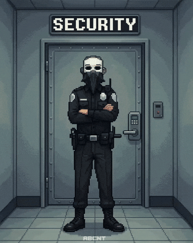
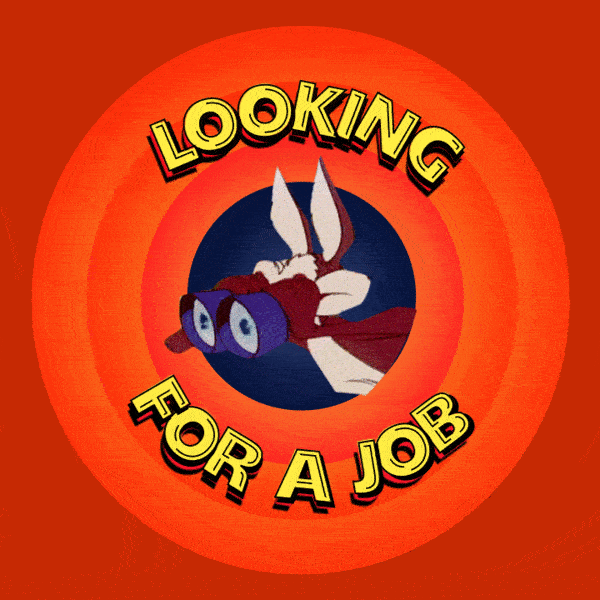

  <!-- Each row: GIF in its own column on the left, paragraph on the right -->
  

    
    

      I am a <strong>Cloud Security & DevSecOps Engineer</strong> specializing in building secure cloud delivery systems across Azure and AWS. With four years of experience spanning financial services, healthcare, media, and real estate, I embed security into the design, automation, and deployment of infrastructure. Not as an afterthought, but as a foundation.
    

  

  

    
    

      My work centers on three disciplines: <strong> cloud security, DevSecOps, & security automation</strong>. I believe security should be <strong> frictionless for engineering teams</strong>. Whether it is a Terraform policy-as-code gate catching misconfigurations at commit time, a SOAR playbook reducing mean time to resolution, or a federated identity model enforcing least privilege across hybrid cloud, I build solutions that hold up in production.
    

  

  

    
    

      Currently open to <strong> full-time Cloud Security, DevSecOps, and Security Automation Engineering roles</strong>.
    

  

## Timeline



  

<!--
## Accolades

  

    
  

  

    
  

  

    
  

  

    
  

  

    
  

-->
