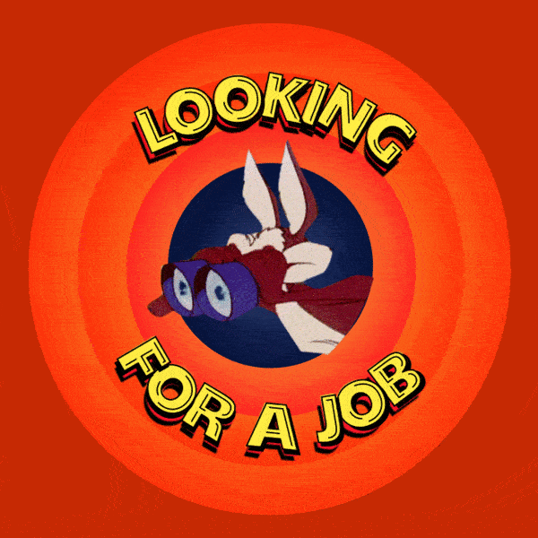

  <!-- Each row: GIF in its own column on the left, paragraph on the right -->
  

    
    

      I am a <strong>Security Engineer</strong> specializing in cloud and AI. I've been at it for four years now spanning from different industries like financial services, healthcare, media, and real estate.
    

  

  

    
    

      Mostly focused in Microsoft 365 & Azure Security but I am knowledgable in AWS as well.
    

  

  

    
    

      Currently open to <strong> full-time Cloud and AI Security Engineering roles</strong>.
    

  

## Timeline



  

<!--
## Accolades

  

    
  

  

    
  

  

    
  

  

    
  

  

    
  

-->
